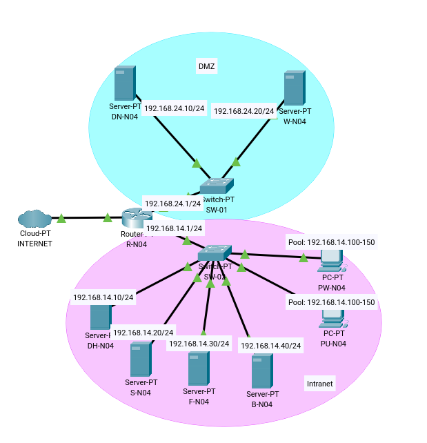

# P0.0-ASIXc2gC-G04

Mòdul 0379 · Projecte intermodular d'administració de sistemes informàtics en xarxa
Activitat P0.0 · Desplegament d'infraestructura

## Equip
Laia · Brenda · Aleshka

## Objectiu
Preparar la infraestructura per una aplicació multicapa (Web Server-Monitor de xarxes-ssh-BBDD-DHCP-DNS-FTP).

## Arquitectura

## Asignació de les màquines
| Nom | Equip | Xarxa | Adreça / Màscara | Gateway | Encarregada |
|---|---|---|---|---|---|
| R-N04 | Router | NAT | Dinàmica (DHCP) | - | Laia |
| | | Intranet | 192.168.14.1/24 | - | |
| | | DMZ | 192.168.24.1/24 | - | |
| DN-N04 | DNS | DMZ | 192.168.24.10/24 | 192.168.24.1 | Brenda |
| W-N04 | Web | DMZ | 192.168.24.20/24 | 192.168.24.1 | Aleshka |
| DH-N04 | DHCP | Intranet | 192.168.14.10/24 | 192.168.14.1 | Brenda |
| S-N04 | SSH | Intranet | 192.168.14.20/24 | 192.168.14.1 | Laia |
| F-N04 | FTP | Intranet | 192.168.14.30/24 | 192.168.14.1 | Laia |
| B-N04 | BDD | Intranet | 192.168.14.40/24 | 192.168.14.1 | Aleshka |
| PW-N04 | Client Win | Intranet | 192.168.14.100 - 150 | 192.168.14.1 | Brenda |
| PU-N04 | Client Ubuntu | Intranet | 192.168.14.100 - 150 | 192.168.14.1 | Aleshka |

## Documentació
- [Arquitectura](docs/01-arquitectura/README.md)
- (poner más cuando tengamos...)

## Credencials de comprovació
Usuari `bchecker` / contrasenya `bchecker121` a tots els sistemes.