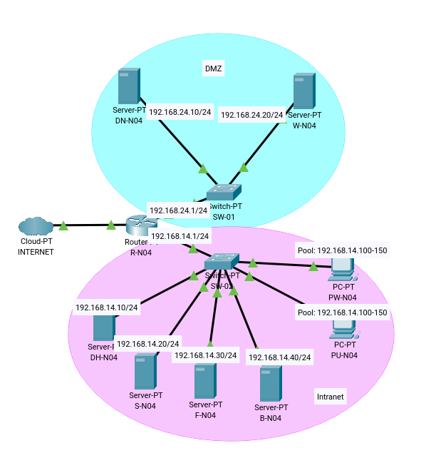
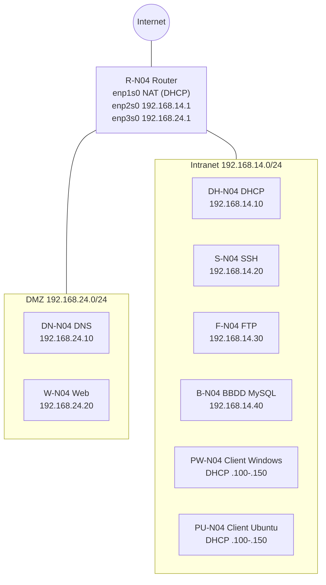

# P0.0-ASIXc2gC-G04

Mòdul 0379 · Projecte intermodular d'administració de sistemes informàtics en xarxa
Activitat P0.0 · Desplegament d'infraestructura

## Equip
Laia · Brenda · Aleshka

## Objectiu
Preparar la infraestructura per una aplicació multicapa (Web Server-Monitor de xarxes-ssh-BBDD-DHCP-DNS-FTP).

## Índex
- [Arquitectura](docs/01-arquitectura/README.md)
- [Planificació](docs/02-planificació/README.md)
- (...)

## Arquitectura

## Asignació de les màquines
| Nom | Equip | Xarxa | Adreça / Màscara | Gateway | Encarregada |
|---|---|---|---|---|---|
| R-N04 | Router | NAT | Dinàmica (DHCP) | - | Laia |
| | | Intranet | 192.168.14.1/24 | - | |
| | | DMZ | 192.168.24.1/24 | - | |
| DN-N04 | DNS | DMZ | 192.168.24.10/24 | 192.168.24.1 | Brenda |
| W-N04 | Web | DMZ | 192.168.24.20/24 | 192.168.24.1 | Aleshka |
| DH-N04 | DHCP | Intranet | 192.168.14.10/24 | 192.168.14.1 | Brenda |
| S-N04 | SSH | Intranet | 192.168.14.20/24 | 192.168.14.1 | Laia |
| F-N04 | FTP | Intranet | 192.168.14.30/24 | 192.168.14.1 | Laia |
| B-N04 | BDD | Intranet | 192.168.14.40/24 | 192.168.14.1 | Aleshka |
| PW-N04 | Client Win | Intranet | 192.168.14.100 - 150 | 192.168.14.1 | Brenda |
| PU-N04 | Client Ubuntu | Intranet | 192.168.14.100 - 150 | 192.168.14.1 | Aleshka |

## Credencials de comprovació
Usuari `bchecker` / contrasenya `bchecker121` a tots els sistemes.

# Arquitectura 
[(Tornar a l'inici)](/README.md)

## 1. Objectiu

Desplegar la infraestructura per a una aplicació multicapa formada per:
servidor web, SSH, base de dades, DHCP, DNS i FTP, amb un router que
separa tres xarxes: NAT, Intranet i DMZ.

## 2. Diagrama

## 3. Xarxes

| Xarxa | Adreçament | Interfície del router | Funció |
|---|---|---|---|
| NAT | DHCP (dinàmica) | enp1s0 | Sortida a Internet |
| Intranet | 192.168.14.0/24 | enp2s0 (192.168.14.1) | Serveis interns i clients |
| DMZ | 192.168.24.0/24 | enp3s0 (192.168.24.1) | Serveis exposats (DNS, web) |

## 4. Funció de cada equip

| Capa | Equips | Funció |
|---|---|---|
| Xarxa | R-N04 | Encaminament, NAT i filtratge entre xarxes |
| Presentació | W-N04 | Servidor web de l'aplicació |
| Dades | B-N04 | Base de dades MySQL amb el CSV d'equipaments educatius |
| Serveis de xarxa | DN-N04, DH-N04 | Resolució de noms i assignació d'adreces |
| Administració | S-N04 | Accés remot segur per SSH (punt d'administració) |
| Transferència | F-N04 | Servidor FTP |
| Clients | PW-N04, PU-N04 | Equips d'usuari per provar la infraestructura |

## 5. Política de seguretat entre xarxes

| Origen → Destí | Permès |
|---|---|
| Intranet → Internet | Sí |
| Intranet → DMZ | Sí |
| DMZ → Intranet | No, menys W-N04 → B-N04 |
| Internet → Intranet | No |

Justificació: la DMZ allotja serveis accessibles, així que si un d'ells es
compromet no ha de poder arribar a la Intranet ni sortir lliurement a
Internet.

## 6. Accés als sistemes

Tots els sistemes tenen l'usuari `bchecker` / `bchecker121`, accessible per SSH .

## 7. Decisions de disseny

- Router amb tres interfícies per aïllar DMZ i Intranet.
- NAT (masquerade) a enp1s0 perquè la Intranet surti a Internet.
- SSH centralitzat a S-N04 com a punt d'administració.
- BBDD a la Intranet (no exposada) i web a la DMZ.

# Planificació
[(Tornar a l'inici)](/README.md)

## 1. Metodologia

El projecte es planifica amb **ProofHub** seguint una metodologia àgil:

- Sprints quinzenals de 10 h de feina per persona (5 h setmanals).
- 3 sprints en total.
- Projecte a ProofHub: `P0.0-ASIXc2gC-G04`.
- Backlog de projecte amb totes les tasques definides a ProofHub.

## 2. Equip i responsabilitats

| Persona | Equips assignats |
|---|---|
| Laia | R-N04 (router), S-N04 (SSH), F-N04 (FTP) |
| Brenda | DN-N04 (DNS), DH-N04 (DHCP), PW-N04 (client Windows) |
| Aleshka | W-N04 (web), B-N04 (BBDD), PU-N04 (client Ubuntu) |

## 3. Calendari de sprints

| Sprint | Dates (MODIFICAR!!!!!) | Objectiu |
|---|---|---|
| Sprint 1 | 07/10 – 20/10 | Xarxa base i serveis fonamentals |
| Sprint 2 | 21/10 – 03/11 | Serveis de dades, web i clients |
| Sprint 3 | 04/11 – 18/11 | Aplicació de proves, documentació i tancament |

## 4. Backlog de projecte

### Sprint 1 · Xarxa base i serveis fonamentals

| Tasca | Estat |
|---|---|
| Definir diagrama d'arquitectura | ✅ |
| Crear repositori GitHub i estructura de documentació | ✅ |
| Desplegar router R-N04 (3 interfícies) | ✅ |
| Configurar IP forwarding i NAT al router | ✅ |
| Desplegar servidor DNS DN-N04 | ✅  |
| Desplegar servidor DHCP DH-N04 | ✅  |

### Sprint 2 · Serveis de dades, web i clients

| Tasca | Estat |
|---|---|
| Desplegar servidor SSH S-N04 | ☐ |
| Regles de filtratge entre DMZ, Intranet i NAT | ☐  |
| Desplegar servidor FTP F-N04 | ☐ |
| Desplegar B-N04 amb MySQL | ☐ |
| Descarregar CSV i carregar-lo a la BBDD | ☐ |
| Desplegar servidor web W-N04 | ☐ |
| Configurar DNS: resolució de `R-N04` i `R` | ☐ |
| Client Windows PW-N04 (DHCP + SSH) | ☐ |
| Client Ubuntu PU-N04 (DHCP + SSH) | ☐ |

### Sprint 3 · Aplicació, documentació i tancament

| Tasca | Estat |
|---|---|
| Aplicació que mostri les taules carregades | ☐ |
| Regla del router: web (DMZ) → MySQL (Intranet) | ☐ |
| Clau pública/privada servidor ↔ GitHub | ☐ |
| Documentar control de versions (git add/commit/push/pull/clone) | ☐ |
| Documentació de cada servei amb captures | ☐ |
| Proves finals d'extrem a extrem | ☐ |
| Revisió final del repositori i lliurament | ☐ |

## 5. Seguiment

- Reunió de revisió al final de cada sprint.
- Estat de les tasques actualitzat a ProofHub.
- Els problemes trobats es documenten a cada README de servei.

## 6. Captures de ProofHub

(PONER LAS CAPTURAS DEL PROOFHUB!!!!!!!!!!!!!!!!!!!!!!!!! gracias.)

[(Tornar a l'inici)](/README.md)