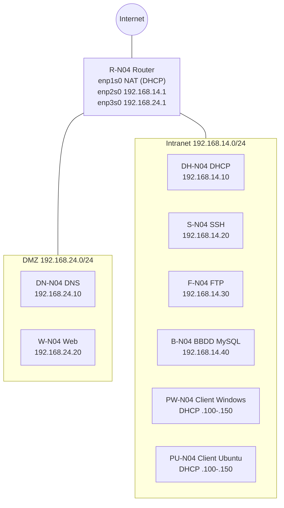
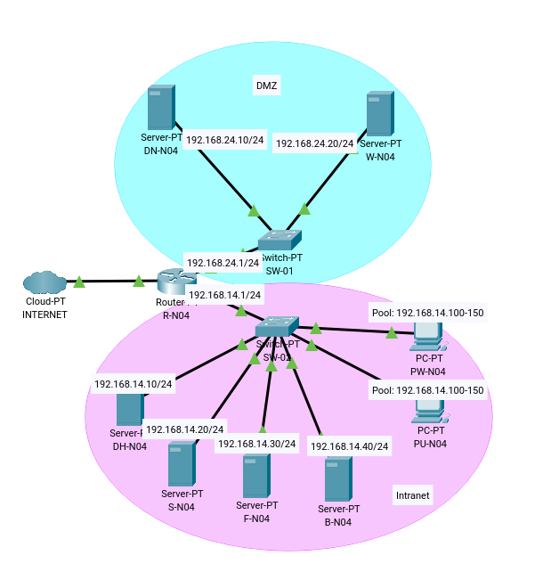

# P0.0-ASIXc2BC-G04
 
Mòdul 0379 · Projecte intermodular d'administració de sistemes informàtics en xarxa
Activitat P0.0 · Desplegament d'infraestructura
 
## Equip
Laia · Brenda · Aleshka
 
## Objectiu
Preparar la infraestructura per una aplicació multicapa (Web Server-Monitor de xarxes-ssh-BBDD-DHCP-DNS-FTP).
 
## Índex
1. [Arquitectura](#1-arquitectura)
2. [Planificació](#2-planificació)
3. [Configuració comuna a totes les màquines](#3-configuració-comuna-a-totes-les-màquines)
4. [Router R-N04](#4-router-r-n04)
5. [Servidor DNS DN-N04](#5-servidor-dns-dn-n04)
6. [Servidor DHCP DH-N04](#6-servidor-dhcp-dh-n04)
7. [Servidor SSH S-N04](#7-servidor-ssh-s-n04)
8. [Servidor FTP F-N04](#8-servidor-ftp-f-n04)
9. [Servidor de base de dades B-N04](#9-servidor-de-base-de-dades-b-n04)
10. [Servidor web W-N04](#10-servidor-web-w-n04)
11. [Clients PW-N04 i PU-N04](#11-clients-pw-n04-i-pu-n04)
12. [Control de versions amb Git i GitHub](#12-control-de-versions-amb-git-i-github)
13. [Proves finals](#13-proves-finals)
14. [Problemes trobats](#14-problemes-trobats)
---
 
## 1. Arquitectura
 
### 1.1 Objectiu
Desplegar la infraestructura per a una aplicació multicapa formada per:
servidor web, SSH, base de dades, DHCP, DNS i FTP, amb un router que
separa tres xarxes: NAT, Intranet i DMZ.
 
### 1.2 Diagrama
 

 

 
### 1.3 Assignació de les màquines
 
| Nom | Equip | Xarxa | Adreça / Màscara | Gateway | Encarregada |
|---|---|---|---|---|---|
| R-N04 | Router | NAT | Dinàmica (DHCP) | - | Laia |
| | | Intranet | 192.168.14.1/24 | - | |
| | | DMZ | 192.168.24.1/24 | - | |
| DN-N04 | DNS | DMZ | 192.168.24.10/24 | 192.168.24.1 | Brenda |
| W-N04 | Web | DMZ | 192.168.24.20/24 | 192.168.24.1 | Aleshka |
| DH-N04 | DHCP | Intranet | 192.168.14.10/24 | 192.168.14.1 | Brenda |
| S-N04 | SSH | Intranet | 192.168.14.20/24 | 192.168.14.1 | Laia |
| F-N04 | FTP | Intranet | 192.168.14.30/24 | 192.168.14.1 | Laia |
| B-N04 | BDD | Intranet | 192.168.14.40/24 | 192.168.14.1 | Aleshka |
| PW-N04 | Client Win | Intranet | 192.168.14.100 - 150 | 192.168.14.1 | Brenda |
| PU-N04 | Client Ubuntu | Intranet | 192.168.14.100 - 150 | 192.168.14.1 | Aleshka |
 
### 1.4 Xarxes
 
| Xarxa | Adreçament | Interfície del router | Funció |
|---|---|---|---|
| NAT | DHCP (dinàmica) | enp1s0 | Sortida a Internet |
| Intranet | 192.168.14.0/24 | enp2s0 (192.168.14.1) | Serveis interns i clients |
| DMZ | 192.168.24.0/24 | enp3s0 (192.168.24.1) | Serveis exposats (DNS, web) |
 
### 1.5 Funció de cada equip
 
| Capa | Equips | Funció |
|---|---|---|
| Xarxa | R-N04 | Encaminament, NAT i filtratge entre xarxes |
| Presentació | W-N04 | Servidor web de l'aplicació |
| Dades | B-N04 | Base de dades MySQL amb el CSV d'equipaments educatius |
| Serveis de xarxa | DN-N04, DH-N04 | Resolució de noms i assignació d'adreces |
| Administració | S-N04 | Accés remot segur per SSH (punt d'administració) |
| Transferència | F-N04 | Servidor FTP |
| Clients | PW-N04, PU-N04 | Equips d'usuari per provar la infraestructura |
 
### 1.6 Política de seguretat entre xarxes
 
| Origen → Destí | Permès |
|---|---|
| Intranet → Internet | Sí |
| Intranet → DMZ | Sí |
| DMZ → Internet | Només DNS (53) i actualitzacions (80/443) |
| DMZ → Intranet | No, menys W-N04 → B-N04 (MySQL, port 3306) |
| Internet → Intranet | No |
 
Justificació: la DMZ allotja serveis accessibles, així que si un d'ells es
compromet no ha de poder arribar a la Intranet ni sortir lliurement a
Internet.
 
### 1.7 Decisions de disseny
- Router amb tres interfícies per aïllar DMZ i Intranet.
- NAT (masquerade) a enp1s0 perquè la Intranet surti a Internet.
- SSH centralitzat a S-N04 com a punt d'administració.
- BBDD a la Intranet (no exposada) i web a la DMZ.
### 1.8 Credencials de comprovació
Usuari `bchecker` / contrasenya `bchecker121` a tots els sistemes i aplicacions
(sistema operatiu, MySQL i FTP).
 
---
 
## 2. Planificació
 
### 2.1 Metodologia
El projecte es planifica amb **ProofHub** seguint una metodologia àgil:
- Sprints quinzenals de 10 h de feina per persona (5 h setmanals).
- 3 sprints en total (6 setmanes, fins al 18/11).
- Projecte a ProofHub: `P0.0-ASIXc2BC-G04`.
- Backlog de projecte amb totes les tasques definides a ProofHub.
- Tauler amb les columnes: *Desenvolupament*, *Proves*, *Llest per implementar* i *Implementat*.
### 2.2 Equip i responsabilitats
 
| Persona | Equips assignats |
|---|---|
| Laia | R-N04 (router), S-N04 (SSH), F-N04 (FTP) |
| Brenda | DN-N04 (DNS), DH-N04 (DHCP), PW-N04 (client Windows) |
| Aleshka | W-N04 (web), B-N04 (BBDD), PU-N04 (client Ubuntu) |
 
### 2.3 Calendari de sprints
 
| Sprint | Dates | Objectiu |
|---|---|---|
| Sprint 1 | 07/10 – 20/10 | Xarxa base i serveis fonamentals |
| Sprint 2 | 21/10 – 03/11 | Serveis de dades, web i clients |
| Sprint 3 | 04/11 – 18/11 | Aplicació de proves, documentació i tancament |
 
### 2.4 Backlog de projecte
 
#### Sprint 1 · Xarxa base i serveis fonamentals
 
| Tasca | Estat |
|---|---|
| Definir diagrama d'arquitectura | ✅ |
| Crear repositori GitHub i estructura de documentació | ✅ |
| Desplegar router R-N04 (3 interfícies) | ✅ |
| Configurar IP forwarding i NAT al router | ✅ |
| Desplegar servidor DNS DN-N04 | ✅ |
| Desplegar servidor DHCP DH-N04 | ✅ |
 
#### Sprint 2 · Serveis de dades, web i clients
 
| Tasca | Estat |
|---|---|
| Desplegar servidor SSH S-N04 | ☐ |
| Regles de filtratge entre DMZ, Intranet i NAT | ☐ |
| Desplegar servidor FTP F-N04 | ☐ |
| Desplegar B-N04 amb MySQL | ☐ |
| Descarregar CSV i carregar-lo a la BBDD | ☐ |
| Desplegar servidor web W-N04 | ☐ |
| Configurar DNS: resolució de `R-N04` i `R` | ☐ |
| Client Windows PW-N04 (DHCP + SSH) | ☐ |
| Client Ubuntu PU-N04 (DHCP + SSH) | ☐ |
 
#### Sprint 3 · Aplicació, documentació i tancament
 
| Tasca | Estat |
|---|---|
| Aplicació que mostri les taules carregades | ☐ |
| Regla del router: web (DMZ) → MySQL (Intranet) | ☐ |
| Clau pública/privada servidor ↔ GitHub | ☐ |
| Documentar control de versions (git add/commit/push/pull/clone) | ☐ |
| Documentació de cada servei | ☐ |
| Proves finals d'extrem a extrem | ☐ |
| Revisió final del repositori i lliurament | ☐ |
 
### 2.5 Seguiment
- Reunió de revisió al final de cada sprint.
- Estat de les tasques actualitzat a ProofHub.
- Els problemes trobats es documenten a l'apartat [14](#14-problemes-trobats).
### 2.6 Captures de ProofHub
(PENDENT: afegir captures del backlog i del tauler de cada sprint.)
 
---
 
## 3. Configuració comuna a totes les màquines
 
Abans de configurar cada servei, a **totes** les màquines Linux fem el mateix:
posar-li el nom (hostname), donar-li la seva IP fixa i crear l'usuari `bchecker`
que exigeix l'enunciat.
 
### 3.1 Posar el nom de la màquina
```bash
sudo hostnamectl set-hostname S-N04     # canviar pel nom de cada màquina
```
 
### 3.2 IP fixa amb Netplan
Editem el fitxer de Netplan (el nom pot variar, es pot veure amb `ls /etc/netplan/`):
```bash
sudo nano /etc/netplan/50-cloud-init.yaml
```
Exemple per a una màquina de la Intranet (S-N04):
```yaml
network:
  version: 2
  ethernets:
    enp1s0:
      dhcp4: false
      addresses: [192.168.14.20/24]
      routes:
        - to: default
          via: 192.168.14.1
      nameservers:
        addresses: [192.168.24.10]
        search: [g04.lan]
```
- `addresses`: la IP de la màquina (vegeu la taula 1.3).
- `via`: el gateway, que és el router (192.168.14.1 a la Intranet, 192.168.24.1 a la DMZ).
- `nameservers`: el nostre DNS, DN-N04.
Aplicar i comprovar:
```bash
sudo netplan apply
ip a                    # veure la IP
ping -c 3 192.168.14.1  # comprovar que arribem al router
```
 
### 3.3 Crear l'usuari bchecker
```bash
sudo adduser bchecker            # contrasenya: bchecker121
sudo usermod -aG sudo bchecker   # li donem permisos d'administració
```
 
---
 
## 4. Router R-N04
 
**Què farem:** convertir una màquina Ubuntu Server amb tres targetes de xarxa en el
router del projecte. Una interfície surt a Internet (NAT), una altra connecta amb la
Intranet i la tercera amb la DMZ. Activarem el reenviament de paquets perquè pugui
passar trànsit d'una xarxa a una altra, farem NAT perquè les xarxes internes surtin
a Internet amb la IP del router, i posarem regles de tallafocs per complir la
política de seguretat de l'apartat 1.6.
 
### 4.1 Nom i usuari
```bash
sudo hostnamectl set-hostname R-N04
sudo adduser bchecker
sudo usermod -aG sudo bchecker
```
 
### 4.2 Configurar les 3 interfícies
```bash
sudo nano /etc/netplan/50-cloud-init.yaml
```
```yaml
network:
  version: 2
  ethernets:
    enp1s0:            # NAT: rep IP per DHCP i surt a Internet
      dhcp4: true
    enp2s0:            # Intranet
      dhcp4: false
      addresses: [192.168.14.1/24]
    enp3s0:            # DMZ
      dhcp4: false
      addresses: [192.168.24.1/24]
```
Només la interfície NAT té gateway (el rep per DHCP). Les altres dues no en porten
perquè el router **és** el gateway d'aquestes xarxes.
 
```bash
sudo netplan apply
ip a        # comprovar que les tres interfícies tenen la seva IP
```
 
### 4.3 Activar el reenviament de paquets (IP forwarding)
Per defecte Linux no passa paquets d'una interfície a una altra. Ho activem:
```bash
echo "net.ipv4.ip_forward=1" | sudo tee -a /etc/sysctl.conf
sudo sysctl -p
```
Comprovació (ha de sortir `1`):
```bash
cat /proc/sys/net/ipv4/ip_forward
```
 
### 4.4 NAT (masquerade)
Instal·lem el paquet que permet guardar les regles perquè no es perdin en reiniciar:
```bash
sudo apt update
sudo apt install iptables-persistent
```
Regla de NAT: tot el que surti per la interfície d'Internet (enp1s0) surt amb la IP
del router.
```bash
sudo iptables -t nat -A POSTROUTING -o enp1s0 -j MASQUERADE
```
 
### 4.5 Regles de tallafocs entre xarxes
Primer bloquegem per defecte tot el trànsit que travessa el router, i després
permetem només el que volem:
 
```bash
# Per defecte, no es deixa passar res entre xarxes
sudo iptables -P FORWARD DROP
 
# Deixar passar les respostes de connexions ja iniciades
sudo iptables -A FORWARD -m state --state ESTABLISHED,RELATED -j ACCEPT
 
# Intranet -> Internet
sudo iptables -A FORWARD -i enp2s0 -o enp1s0 -j ACCEPT
 
# Intranet -> DMZ (els clients han d'arribar al DNS i a la web)
sudo iptables -A FORWARD -i enp2s0 -o enp3s0 -j ACCEPT
 
# DMZ -> Internet només per a DNS i actualitzacions
sudo iptables -A FORWARD -i enp3s0 -o enp1s0 -p udp --dport 53 -j ACCEPT
sudo iptables -A FORWARD -i enp3s0 -o enp1s0 -p tcp --dport 53 -j ACCEPT
sudo iptables -A FORWARD -i enp3s0 -o enp1s0 -p tcp -m multiport --dports 80,443 -j ACCEPT
 
# Única excepció DMZ -> Intranet: el web pot consultar MySQL a B-N04
sudo iptables -A FORWARD -i enp3s0 -o enp2s0 -s 192.168.24.20 -d 192.168.14.40 -p tcp --dport 3306 -j ACCEPT
```
 
Veure les regles i guardar-les:
```bash
sudo iptables -L FORWARD -v -n
sudo iptables -t nat -L -v -n
sudo netfilter-persistent save
```
 
### 4.6 Proves
- Des d'una màquina de la Intranet: `ping 8.8.8.8` → ha de funcionar (NAT).
- Des d'una màquina de la Intranet: `ping 192.168.24.20` → ha de funcionar.
- Des de W-N04: `ping 192.168.14.20` → **no** ha de funcionar (DMZ → Intranet bloquejat).
---
 
## 5. Servidor DNS DN-N04
 
**Què farem:** instal·lar BIND9 a la DMZ perquè resolgui els noms de totes les
màquines del projecte dins del domini `g04.lan`. L'enunciat demana que el router es
pugui trobar pels noms `R-N04` i `R`. Les consultes de fora (google.com, etc.)
es reenvien a un DNS públic.
 
### 5.1 Instal·lació
```bash
sudo hostnamectl set-hostname DN-N04
sudo apt update
sudo apt install bind9 bind9utils dnsutils
```
 
### 5.2 Opcions generals
```bash
sudo nano /etc/bind/named.conf.options
```
```
options {
    directory "/var/cache/bind";
    recursion yes;
    allow-query { 192.168.14.0/24; 192.168.24.0/24; localhost; };
    forwarders { 8.8.8.8; 1.1.1.1; };
    dnssec-validation auto;
    listen-on { any; };
};
```
- `allow-query`: només responem a la Intranet i la DMZ.
- `forwarders`: on enviem les consultes de noms d'Internet.
### 5.3 Declarar la zona
```bash
sudo nano /etc/bind/named.conf.local
```
```
zone "g04.lan" {
    type master;
    file "/etc/bind/db.g04.lan";
};
```
 
### 5.4 Fitxer de zona
```bash
sudo nano /etc/bind/db.g04.lan
```
```
$TTL 604800
@       IN  SOA DN-N04.g04.lan. admin.g04.lan. (
                2         ; Serial (augmentar-lo a cada canvi)
                604800    ; Refresh
                86400     ; Retry
                2419200   ; Expire
                604800 )  ; Negative Cache TTL
@       IN  NS      DN-N04.g04.lan.
 
R-N04   IN  A       192.168.14.1
R       IN  CNAME   R-N04
DN-N04  IN  A       192.168.24.10
W-N04   IN  A       192.168.24.20
DH-N04  IN  A       192.168.14.10
S-N04   IN  A       192.168.14.20
F-N04   IN  A       192.168.14.30
B-N04   IN  A       192.168.14.40
```
`R` és un àlies (CNAME) de `R-N04`, així els dos noms porten al router.
 
### 5.5 Comprovar i arrencar
```bash
sudo named-checkconf
sudo named-checkzone g04.lan /etc/bind/db.g04.lan
sudo systemctl restart bind9
sudo systemctl enable bind9
```
 
### 5.6 Proves
```bash
nslookup R-N04 192.168.24.10
nslookup R 192.168.24.10
nslookup google.com 192.168.24.10
```
 
---
 
## 6. Servidor DHCP DH-N04
 
**Què farem:** instal·lar `isc-dhcp-server` a la Intranet perquè els clients
(PW-N04 i PU-N04) rebin automàticament una IP entre la .100 i la .150, el gateway
(el router) i el DNS (DN-N04).
 
### 6.1 Instal·lació
```bash
sudo hostnamectl set-hostname DH-N04
sudo apt update
sudo apt install isc-dhcp-server
```
 
### 6.2 Indicar per quina interfície escolta
```bash
ip a                                   # mirar el nom de la interfície
sudo nano /etc/default/isc-dhcp-server
```
```
INTERFACESv4="enp1s0"
```
 
### 6.3 Configuració del rang
```bash
sudo nano /etc/dhcp/dhcpd.conf
```
```
option domain-name "g04.lan";
option domain-name-servers 192.168.24.10;
default-lease-time 600;
max-lease-time 7200;
authoritative;
 
subnet 192.168.14.0 netmask 255.255.255.0 {
    range 192.168.14.100 192.168.14.150;
    option routers 192.168.14.1;
    option broadcast-address 192.168.14.255;
}
```
 
### 6.4 Arrencar
```bash
sudo dhcpd -t -cf /etc/dhcp/dhcpd.conf     # comprovar la sintaxi
sudo systemctl restart isc-dhcp-server
sudo systemctl enable isc-dhcp-server
sudo systemctl status isc-dhcp-server
```
 
### 6.5 Proves
Veure les IP que s'han repartit:
```bash
cat /var/lib/dhcp/dhcpd.leases
```
 
---
 
## 7. Servidor SSH S-N04
 
**Què farem:** instal·lar OpenSSH a S-N04, que és el punt d'administració remota
de la infraestructura. Només deixarem entrar l'usuari `bchecker`, prohibirem l'accés
com a root i limitarem els intents d'autenticació. Opcionalment, restringirem
l'accés a la Intranet amb el tallafocs UFW.
 
### 7.1 Instal·lació
```bash
sudo hostnamectl set-hostname S-N04
sudo apt update
sudo apt install openssh-server
sudo systemctl enable --now ssh
systemctl status ssh
```
 
### 7.2 Configuració
```bash
sudo nano /etc/ssh/sshd_config
```
```
Port 22
PermitRootLogin no
PubkeyAuthentication yes
PasswordAuthentication yes
AllowUsers bchecker
MaxAuthTries 3
```
- `PermitRootLogin no`: ningú pot entrar directament com a root.
- `PasswordAuthentication yes`: cal mantenir-ho perquè `bchecker/bchecker121` pugui entrar amb contrasenya, tal com demana l'enunciat.
- `AllowUsers bchecker`: només aquest usuari pot connectar per SSH.
- `MaxAuthTries 3`: màxim de 3 intents de contrasenya per connexió.
Comprovar la sintaxi i reiniciar:
```bash
sudo sshd -t
sudo systemctl restart ssh
```
 
### 7.3 Tallafocs al servidor
```bash
sudo apt install ufw
sudo ufw allow from 192.168.14.0/24 to any port 22 proto tcp
sudo ufw enable
sudo ufw status
```
Amb això només es pot entrar per SSH des de la Intranet.
 
### 7.4 Proves
Des del client Ubuntu (PU-N04):
```bash
ssh bchecker@192.168.14.20
```
Des del client Windows (PW-N04), a PowerShell:
```powershell
ssh bchecker@192.168.14.20
```
 
---
 
## 8. Servidor FTP F-N04
 
**Què farem:** instal·lar el servidor FTP `vsftpd` a la Intranet. Desactivarem
l'accés anònim, només deixarem entrar l'usuari `bchecker`, permetrem pujar fitxers
i tancarem cada usuari dins de la seva carpeta personal (*chroot*) perquè no pugui
navegar per la resta del sistema.
 
### 8.1 Preparació
```bash
sudo hostnamectl set-hostname F-N04
sudo adduser bchecker            # si encara no existeix; contrasenya bchecker121
```
 
### 8.2 Instal·lació
```bash
sudo apt update
sudo apt install vsftpd
sudo systemctl enable --now vsftpd
```
 
Fem una còpia de la configuració original abans de tocar-la:
```bash
sudo cp /etc/vsftpd.conf /etc/vsftpd.conf.original
```
 
### 8.3 Configuració
```bash
sudo nano /etc/vsftpd.conf
```
Buscar aquestes línies (o afegir-les al final si no hi són) i deixar-les així:
```
anonymous_enable=NO
local_enable=YES
write_enable=YES
local_umask=022
chroot_local_user=YES
allow_writeable_chroot=YES
pasv_enable=YES
pasv_min_port=40000
pasv_max_port=40100
userlist_enable=YES
userlist_file=/etc/vsftpd.userlist
userlist_deny=NO
```
- `anonymous_enable=NO`: no es pot entrar sense usuari.
- `local_enable=YES`: poden entrar els usuaris del sistema.
- `write_enable=YES`: es poden pujar fitxers.
- `chroot_local_user=YES`: l'usuari queda tancat a la seva carpeta personal.
- `allow_writeable_chroot=YES`: necessari perquè el chroot funcioni si la carpeta és editable.
- `pasv_*`: ports del mode passiu, que fan servir la majoria de clients FTP.
- `userlist_*` amb `userlist_deny=NO`: **només** poden entrar els usuaris que hi ha a la llista.
### 8.4 Llista d'usuaris permesos
```bash
echo "bchecker" | sudo tee /etc/vsftpd.userlist
```
 
### 8.5 Reiniciar
```bash
sudo systemctl restart vsftpd
sudo systemctl status vsftpd
```
 
### 8.6 Tallafocs (si UFW està activat)
```bash
sudo ufw allow 20:21/tcp
sudo ufw allow 40000:40100/tcp
sudo ufw status
```
 
### 8.7 Proves
Des del client Ubuntu (PU-N04):
```bash
echo "Prova FTP G04" > prova.txt
ftp 192.168.14.30
```
Dins de la sessió FTP:
```
Name: bchecker
Password: bchecker121
ftp> put prova.txt
ftp> ls
ftp> bye
```
Si `ftp` no està instal·lat: `sudo apt install ftp`.
 
Des del client Windows (PW-N04): obrir l'Explorador de fitxers i escriure
`ftp://192.168.14.30`, o fer servir FileZilla amb l'usuari `bchecker`.
 
Comprovar que l'accés anònim està bloquejat: entrar amb l'usuari `anonymous`
ha de donar error.
 
---
 
## 9. Servidor de base de dades B-N04
 
**Què farem:** instal·lar MySQL a la Intranet, crear una base de dades i l'usuari
`bchecker`, i carregar-hi el CSV d'equipaments d'educació de Barcelona (Open Data
BCN). Configurarem MySQL perquè accepti connexions del servidor web W-N04.
 
### 9.1 Instal·lació
```bash
sudo hostnamectl set-hostname B-N04
sudo apt update
sudo apt install mysql-server
sudo systemctl enable --now mysql
```
 
### 9.2 Permetre connexions des de la xarxa
Per defecte MySQL només escolta a `127.0.0.1`. Ho canviem:
```bash
sudo nano /etc/mysql/mysql.conf.d/mysqld.cnf
```
```
bind-address = 0.0.0.0
```
```bash
sudo systemctl restart mysql
```
 
### 9.3 Base de dades i usuari
```bash
sudo mysql
```
```sql
CREATE DATABASE equipaments CHARACTER SET utf8mb4;
CREATE USER 'bchecker'@'%' IDENTIFIED BY 'bchecker121';
GRANT ALL PRIVILEGES ON equipaments.* TO 'bchecker'@'%';
FLUSH PRIVILEGES;
EXIT;
```
 
### 9.4 Descarregar el CSV