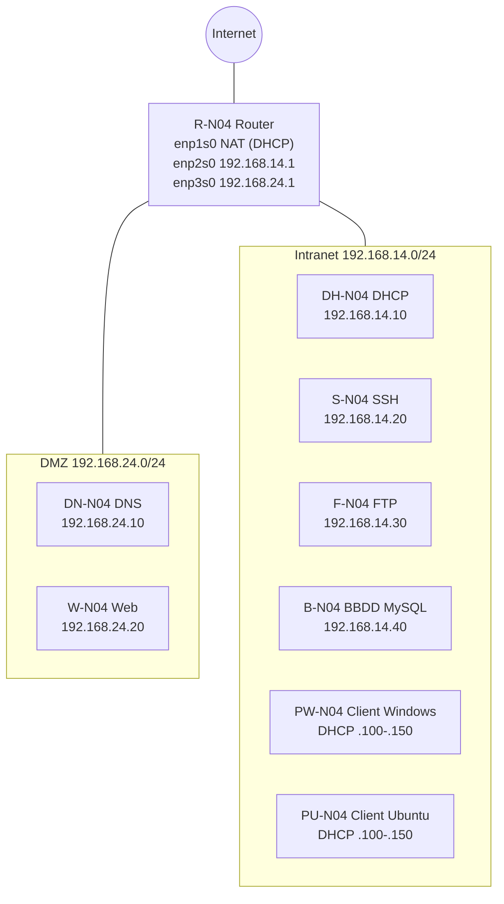

# Arquitectura

## 1. Objectiu

Desplegar la infraestructura per a una aplicació multicapa formada per:
servidor web, SSH, base de dades, DHCP, DNS i FTP, amb un router que
separa tres xarxes: NAT, Intranet i DMZ.

## 2. Diagrama

## 3. Xarxes

| Xarxa | Adreçament | Interfície del router | Funció |
|---|---|---|---|
| NAT | DHCP (dinàmica) | enp1s0 | Sortida a Internet |
| Intranet | 192.168.14.0/24 | enp2s0 (192.168.14.1) | Serveis interns i clients |
| DMZ | 192.168.24.0/24 | enp3s0 (192.168.24.1) | Serveis exposats (DNS, web) |

## 4. Funció de cada capa

| Capa | Equips | Funció |
|---|---|---|
| Xarxa | R-N04 | Encaminament, NAT i filtratge entre xarxes |
| Presentació | W-N04 | Servidor web de l'aplicació |
| Dades | B-N04 | Base de dades MySQL amb el CSV d'equipaments educatius |
| Serveis de xarxa | DN-N04, DH-N04 | Resolució de noms i assignació d'adreces |
| Administració | S-N04 | Accés remot segur per SSH (punt d'administració) |
| Transferència | F-N04 | Servidor FTP |
| Clients | PW-N04, PU-N04 | Equips d'usuari per provar la infraestructura |

## 5. Política de seguretat entre xarxes

| Origen → Destí | Permès |
|---|---|
| Intranet → Internet | Sí |
| Intranet → DMZ | Sí |
| DMZ → Intranet | No |
| DMZ → Internet | No (només temporalment per instal·lacions) |
| Internet → Intranet | No |

Justificació: la DMZ allotja serveis accessibles, així que si un d'ells es
compromet no ha de poder arribar a la Intranet ni sortir lliurement a
Internet.

## 6. Accés als sistemes

Tots els sistemes tenen l'usuari `bchecker` / `bchecker121`
(requisit del projecte), accessible per SSH (port 22).

## 7. Decisions de disseny

- Router amb tres interfícies per aïllar DMZ i Intranet.
- NAT (masquerade) a enp1s0 perquè la Intranet surti a Internet.
- SSH centralitzat a S-N04 com a punt d'administració.
- BBDD a la Intranet (no exposada) i web a la DMZ.